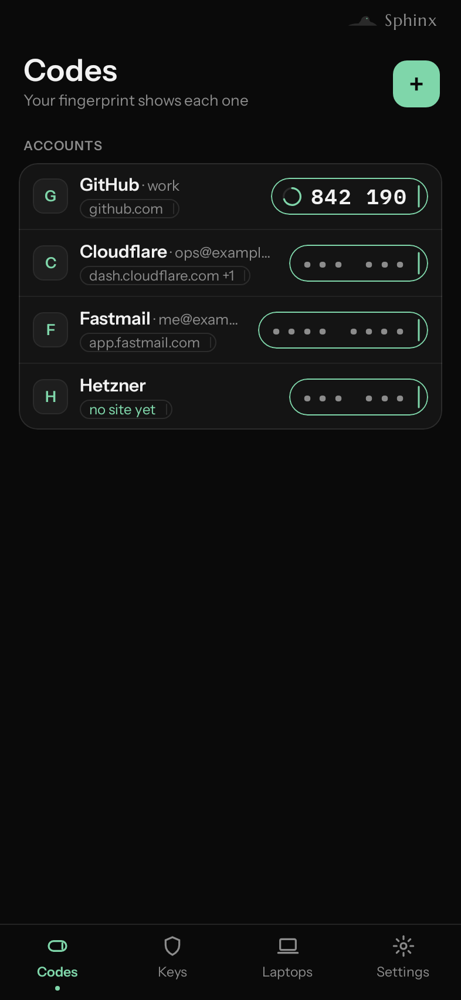
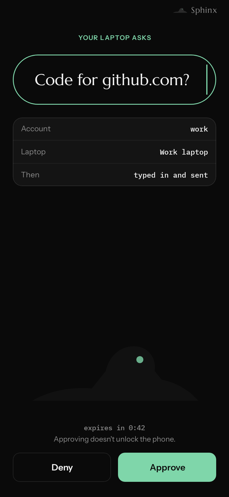
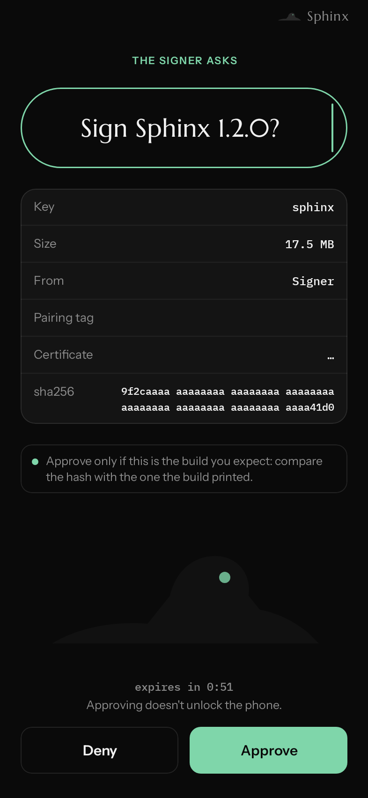
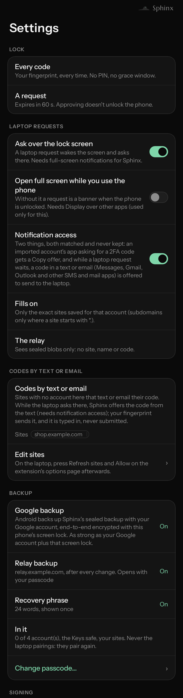
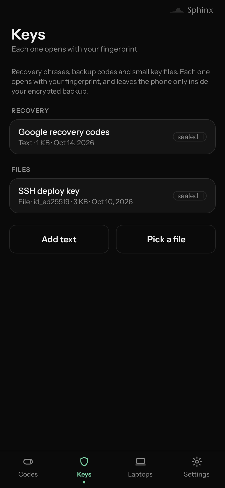
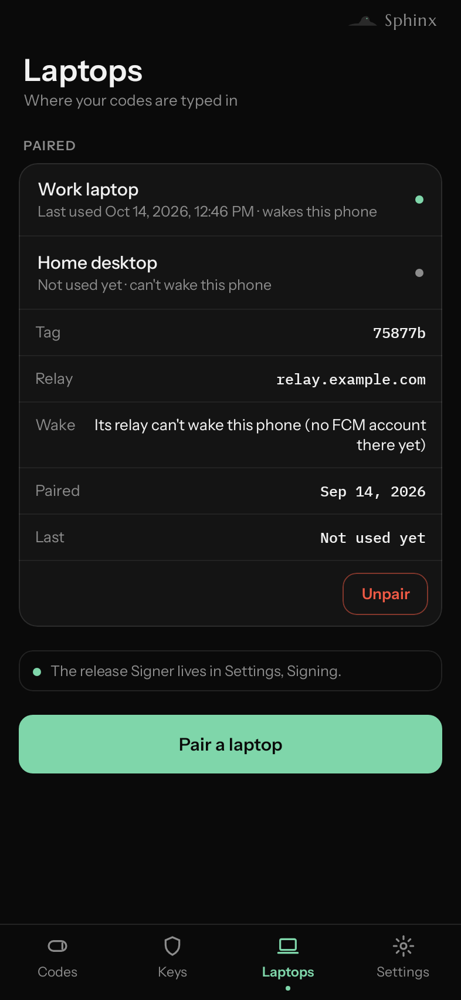
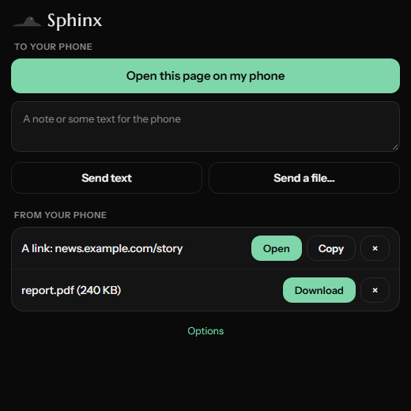
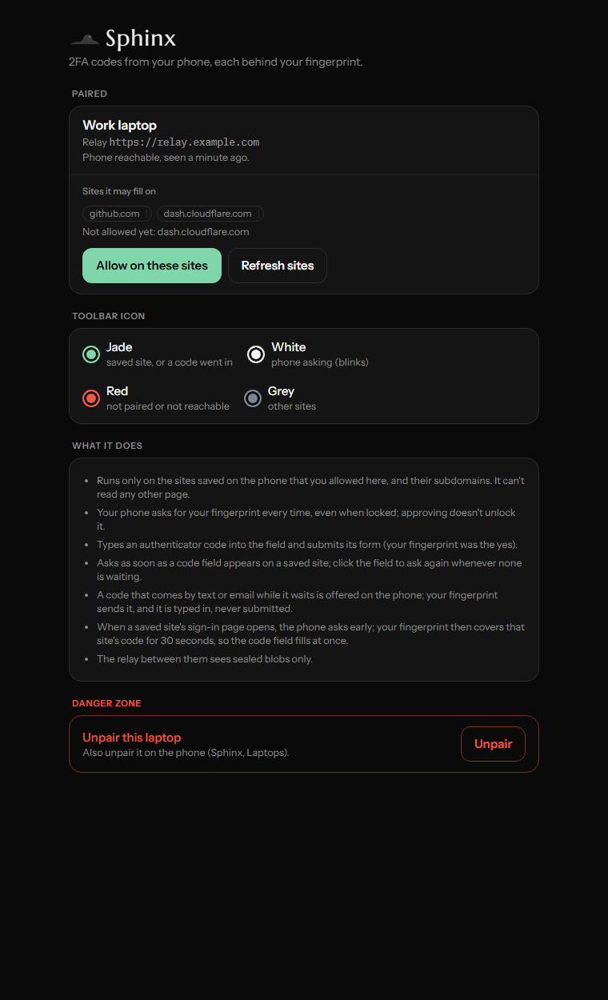

# Sphinx

**Your 2FA codes, behind your fingerprint, typed into your laptop for you.**

The Sphinx asks one question, and only the right answer gets past. That is the whole job of a second factor.

<p>
  
  
  
</p>

## Why I built this
Two-factor codes are still mostly typed by hand. You unlock the phone, find the right account in a long list, read six
digits, and type them before they change. SMS codes skip the typing, but they can be phished, SIM-swapped and read
by anyone who sees the lock screen. The authenticator apps that do help either sync your secrets to someone else's
cloud, or still leave the typing to you.

Sphinx keeps the secrets on the phone, each one behind a fingerprint for every single use. When a website on your
laptop asks for a code, the phone asks you, "Code for github.com?". You touch the sensor, and the code is typed into
that page and only that page. The two talk through a small relay you run yourself, which only ever sees sealed blobs:
it can't read a code, a site or an account name, and it can't forge an answer.

It also sends links, text and files between the phone and the laptop, keeps recovery codes in a fingerprint-locked
safe, and backs everything up so a new phone can restore it.

I built it for myself and run it on my own phone, laptop and server. It is shared as a showcase: it works, and you are
welcome to run your own copy, but there is no hosted service, no app store build and no support. Read
[`docs/DESIGN.md`](docs/DESIGN.md) before you trust it with anything, and keep your current authenticator as a backup
(importing into Sphinx copies your accounts; it never removes them anywhere).

- [Install it](#install-it)
- [What it does](#what-it-does)
- [Screenshots](#screenshots)
- [How it fits together](#how-it-fits-together)
- [Set it up, in detail](#set-it-up-in-detail)
- [Using it](#using-it)
- [Backup and restore](#backup-and-restore)
- [Settings reference](#settings-reference)
- [Relay API](#relay-api)
- [Limits](#limits)
- [If something fails](#if-something-fails)
- [Security review](#security-review)
- [Security, in short](#security-in-short)
- [Testing](#testing)
- [Layout](#layout)

## Install it
**You need:**

| what | why |
|---|---|
| An Android phone, Android 12 (API 31) or newer, with a fingerprint sensor | the app; codes need strong biometrics |
| Chrome or a Chromium browser on the laptop | the extension (Manifest V3) |
| A small Linux server with a public IP and a hostname | the relay, behind Caddy for HTTPS (any small VPS works) |
| A Firebase project (free) | wakes the phone; Sphinx has no always-on connection |
| JDK 17+, the Android SDK (or Android Studio), Python 3.12, Node 20+ | to build and test |

**The quick path** (each step links to its details below):

1. **Firebase.** Create a project, add an Android app `dev.sphinx`, download `google-services.json`, and generate a
   service-account key for the relay. ([details](#1-firebase))
2. **The relay.** On your server: clone this repo, run `deploy/install.sh` with the service-account key, then
   `deploy/install-caddy.sh` for your hostname. Check `https://your-host/healthz` says `{"ok":true}`, and note the
   registration token in `/etc/sphinx/relay.env`. ([details](#2-the-relay))
3. **The app.** Copy `google-services.json` into `app/`, make a signing keystore, write `local.properties`, then build
   in Android Studio or with `./gradlew assembleRelease` and install the APK. ([details](#3-the-app))
4. **The extension.** `chrome://extensions` → Developer mode → Load unpacked → `extension/`. In its options, enter
   your relay and token and show the pairing QR; on the phone, **Laptops → Pair a laptop** and scan it within 10
   minutes. Then **Allow on these sites**. ([details](#4-the-extension))
5. **Try it.** Import an account (**Codes → +**), give it its site, open that site's sign-in page on the laptop and
   approve on the phone.

## What it does
- **Codes on the phone, fully offline.** Import from Google Authenticator (its export QR, multi-part too) or any
  `otpauth://totp/` QR, and pick which accounts come in. Each account is one row; its code stays hidden (`••• •••`)
  until your fingerprint shows it, with a ring counting down its 30 seconds.
- **Codes typed into the laptop.** On a saved site's 2FA page the extension asks the phone. The phone asks
  "Code for github.com?" (over the lock screen too), your fingerprint sends the code back sealed, and the extension
  types it in and submits the form, only if the form posts back to that same site.
- **The code ready before the field asks.** When a saved site's sign-in page opens with a visible password field, the
  phone asks to have the code ready. One fingerprint covers that sign-in: the laptop holds the next codes for 30
  seconds, in memory only, for that pairing and that account, and the code field fills instantly.
- **Codes that arrive by text or email.** While a laptop request is waiting, a code in an SMS or email notification is
  offered: "Send 482913 to the laptop?". It is typed in, never submitted, so you check it first. Sites that only text
  codes can be listed in Settings.
- **The toolbar icon shows the state.** Its whole background changes: jade (a saved site, or a code just went in),
  white and blinking (the phone is asking you), red (not paired, or the phone not seen for 30 minutes), grey (paired,
  another site).
- **Links, text and files between phone and laptop.** Phone: share anything to **Sphinx: Send to laptop** (behind your
  fingerprint). Laptop: the toolbar popup and right-click menu ("Open this page on my phone", a note, the selected
  text, a file up to 8 MB). Nothing opens by itself; you click or tap first. Files land in `Download/Sphinx`.
- **Keys safe.** Recovery phrases, backup codes and small key files, each opened with your fingerprint.
- **Backup, three ways back.** Android's own backup (end-to-end encrypted with your screen lock), a copy on your relay
  that a new phone restores with a passcode, and an optional 24-word recovery phrase.
- **Per-account sites.** Each account has the sites it may fill on, pre-filled for well-known issuers; `*.example.com`
  includes subdomains. Two accounts on one site: the page's user name picks, or you pick once and it's remembered.
- **Several laptops**, each paired separately; unpair from either side.
- **Optional release signing.** A separate signing service on your own server (not part of this repository) can pair as
  "Signer" and ask the phone to approve each APK it signs, showing the whole hash first.

## Screenshots
All made from sample data (no real accounts), rendered by the app's own screenshot tests (`ScreenShots.kt`).

| Codes | Approve a code | Approve a signing |
|---|---|---|
|  |  |  |

| Settings | Keys safe | Laptops |
|---|---|---|
|  |  |  |

| Extension popup | Extension options |
|---|---|
|  |  |

The look is "basalt and jade": black, white type, one jade accent; Instrument Sans for the interface, IBM Plex Mono for
codes and hashes, Marcellus for the name. Fonts are bundled under the SIL Open Font License
([`app/src/main/fonts/FONTS.md`](app/src/main/fonts/FONTS.md)).

## How it fits together

```mermaid
sequenceDiagram
    participant L as Laptop (Chrome extension)
    participant R as Your relay (VPS)
    participant F as Firebase (FCM)
    participant P as Phone (Sphinx app)
    L->>R: sealed "code for github.com?" (signed, HMAC)
    R->>F: wake: the sealed request itself (≤3.5 KB)
    F->>P: high-priority data message
    P->>P: checks seal, counter, expiry and site; asks you
    Note over P: your fingerprint unlocks one secret
    P->>R: sealed code
    R->>L: sealed code (long poll)
    L->>L: types it in, submits the form
```

- **The phone** holds the secrets, each sealed under an Android Keystore key that needs a strong fingerprint on every
  use. It decides; nothing else can.
- **The relay** is a mailbox. Each pairing has an id and an HMAC key; it holds sealed blobs for at most 60 seconds and
  can't read or forge any of them. It wakes the phone through Firebase, carrying the sealed requests (all of them, in
  order) so the phone needs no second round trip. Google sees ciphertext, its size and its timing.
- **The extension** runs only on the exact sites you allowed, top frame only, and never trusts the page: the site name
  comes from Chrome, not from the page.
- Laptop and phone agree on keys once, at pairing, through an X25519 exchange plus a secret that only the QR carries.

## Set it up, in detail
Follow these in order. Each step says how to check it worked.

### 1. Firebase
1. [console.firebase.google.com](https://console.firebase.google.com): **Add project**, any name, Analytics off.
2. **Add app → Android**, package `dev.sphinx` (or your own id if you change `applicationId`). Skip the SHA fields.
3. Download `google-services.json` and keep it outside the repo. You'll copy it into `app/` before building.
4. **Project settings → Cloud Messaging**: check "Firebase Cloud Messaging API (V1)" says Enabled.
5. **Project settings → Service accounts → Generate new private key**: a JSON file downloads. This is a secret: it lets
   its holder send messages to your phone. It goes only to your relay (step 2).

### 2. The relay
On the server, as root (details and undo steps: [`docs/DEPLOY.md`](docs/DEPLOY.md)):

```sh
git clone <this repo> /root/sphinx-src
scp service-account.json root@your-server:/root/sphinx-fcm.json   # from your computer
bash /root/sphinx-src/deploy/install.sh /root/sphinx-fcm.json && shred -u /root/sphinx-fcm.json
SPHINX_HOST=sphinx.yourdomain.example SPHINX_BIND=<public IP> bash /root/sphinx-src/deploy/install-caddy.sh
curl https://sphinx.yourdomain.example/healthz        # {"ok":true}
```

`install.sh` creates a `sphinx` user (no login), a venv in `/opt/sphinx` (dependencies installed with
`--require-hashes`), `/etc/sphinx/relay.env` with a random registration token, and a hardened systemd unit
listening on a unix socket. `install-caddy.sh` adds a Caddy site for your hostname that passes only `/healthz` and
`/v1/*` and caps request bodies. Your registration token: `grep REGISTER /etc/sphinx/relay.env`. Keep it private: without
it nobody can register a pairing on your relay or reach its backup routes. The relay refuses to start without one
(only `SPHINX_INSECURE_DEV=1`, for a local test relay, runs it open).

### 3. The app
```sh
cp /path/to/google-services.json app/
keytool -genkeypair -keystore sphinx-release.p12 -storetype PKCS12 -alias sphinx -keyalg RSA -keysize 4096 -validity 10000
```

Keep the keystore and its password outside the repo, and back them up: an update must be signed with the same key.
Then create `local.properties` (git-ignored):

```properties
sdk.dir=/path/to/Android/sdk
sphinx.keystore=/path/outside/the/repo/sphinx-release.p12
sphinx.keystore.passfile=/path/outside/the/repo/keystore-password.txt
sphinx.relay=https://sphinx.yourdomain.example
sphinx.relayTokenFile=/path/outside/the/repo/relay-token.txt
```

Build and install, in Android Studio (open the project, build the `release` variant) or from a terminal:

```sh
./gradlew assembleRelease testDebugUnitTest
adb install app/build/outputs/apk/release/app-release.apk
```

A release build refuses to build without `app/google-services.json`. Open Sphinx, allow notifications, set up your
fingerprint if asked, and import: **Codes → +** (Google Authenticator: ⋮ → Transfer accounts → Export accounts, then
scan its QR with Sphinx).

### 4. The extension
1. `chrome://extensions` → Developer mode on → **Load unpacked** → pick `extension/`.
2. Optional: put `{"token": "<your registration token>"}` in `extension/local.json` (git-ignored) so the options page
   fills the token in by itself.
3. Open the extension's options. Enter your relay address (or set `DEFAULT_RELAY` in `extension/options.js`) and the
   token, name the laptop, and click **Show the pairing code**. The QR is good for 10 minutes; after that, make a new
   one.
4. On the phone: **Laptops → Pair a laptop**, and scan the QR. The icon turns grey (paired).
5. Back in the options: **Allow on these sites**, so Chrome lets the extension run on your saved sites.

### 5. Try it
Open a saved site's sign-in page. The icon blinks white and the phone asks. Approve, sign in, and the code fills.

### 6. Optional: texted codes
**Settings → Notification access** on the phone. Sphinx reads only the listed SMS and mail apps, and only while a
laptop request is waiting. It keeps nothing. Sites that only ever text you a code go under **Settings → Codes by text
or email**.

## Using it
| on the laptop | what happens |
|---|---|
| A saved site's sign-in page opens | phone asks to have the code ready for 30 s; approve and the code field fills by itself |
| A 2FA field appears (no pre-approval) | phone asks "Code for site?"; approve and it's typed and submitted |
| Click into the code field | asks again whenever no request is waiting (only your real clicks count) |
| Right-click → Sphinx → Open this page on my phone | the phone gets a notification: Open / Copy |
| Right-click a link → Send this link | same, for that link |
| Select text → right-click → Send the selected text | the phone gets it with Copy (the clipboard clears after a minute) |
| Toolbar icon → Send a file… | any file up to 8 MB, saved to `Download/Sphinx` on the phone |

| on the phone | what happens |
|---|---|
| Share → Sphinx: Send to laptop | after your fingerprint, a link opens as "Open on laptop"; text or a file waits in the extension's popup. Files only from an app that shares them properly (Files, Photos) |
| Codes → tap the code | shows it (fingerprint); it hides when it changes |
| Codes → tap the row | its sites, Sites, Delete |
| Codes → + | import from Google Authenticator or an `otpauth` QR |
| Keys | add text or pick a file into the safe; opening one needs your fingerprint |
| Laptops | pair, see, or unpair laptops |

## Backup and restore
All three paths open the same encrypted copy of your state: accounts with their secrets, their sites, text-only
sites and the Keys safe. Laptop pairings are never included; you pair again after a restore.

| path | turn it on | restore on a new phone | as strong as |
|---|---|---|---|
| **Android backup** (primary) | on by default | sign in to Google, restore the phone, enter the old phone's screen lock, open Sphinx, then **Open it** on the Codes card (fingerprint) | your Google account plus your old screen lock |
| **Relay backup** | Settings → Backup → Back up to the relay…, choose a passcode (12+ characters; several words are best) | install Sphinx → Codes → Restore from a backup → your relay → passcode | your passcode against Argon2id (64 MiB, 3 passes), with tries limited on the relay |
| **24-word phrase** | Settings → Backup → Turn on a recovery phrase… (needs the relay backup); shown once, write it down | Restore from a backup… → recovery phrase | the phrase (256 bits) |

- **Changes to the backup need you.** Turning the relay backup on, moving it to another relay, changing its passcode,
  and turning the phrase on each take a fresh fingerprint on the codes key; changing the passcode or the relay also
  takes the current passcode. A restore from the relay asks for your fingerprint first. Passcode fields have
  **Show / Hide**.
- **Set-aside copies.** A Google backup that comes with a new phone is not opened by itself: the Codes tab offers
  "A Google backup came with this phone", and it opens only when you say so. Copying the phone with "Copy apps & data"
  carries the backup but not its key, so that copy opens nothing.
- **A new fingerprint.** Adding a fingerprint makes Android invalidate the codes key, so the codes on the phone are
  cleared. The phone's backup is then set aside, and it reopens only with your relay passcode or recovery phrase,
  never a fingerprint. **Without the relay backup or the phrase, adding a new fingerprint clears your codes for good**
  (Settings → Backup says so while both are off).
- **The relay counts wrong tries per slot:** 3 free per address, then 30 s doubling; 10 free per slot, then 60 s
  doubling; after 25 wrong in a row that slot locks until `rm /var/lib/sphinx/backup.pass.locked` (the passcode's) on
  the server. Every backup route also needs the registration token (or a paired phone's signature), and a pairing's
  own wrong tries are capped and then locked out. A copy of the server's disk can still be guessed offline, limited
  only by your passcode's strength, so use a long one.
- On the phone, the backup's key is stored beside the backup, not behind the fingerprint, so the backup can update
  without asking you each time. Code running as Sphinx, root, or a forensic copy of the phone could open it. Google
  Authenticator makes the same trade.

## Settings reference
**On the phone (Settings)**

| section | what is there |
|---|---|
| Lock | every code needs your fingerprint; a request expires in 60 s and approving doesn't unlock the phone |
| Laptop requests | Ask over the lock screen, Open full screen while you use the phone, Notification access (each opens Android's setting) |
| Codes by text or email | sites that text or email their code |
| Backup | Google backup (always on), Relay backup, Recovery phrase, what is in it, Change passcode… |
| Signing | the unlock secret for the optional release signer, and its pairing |
| Danger zone | turn off the relay backup, turn the phrase off, remove the signing unlock |

**App build (`local.properties`, or the environment)**

| property | env | effect |
|---|---|---|
| `sphinx.keystore` | `SPHINX_KEYSTORE` | the release signing keystore (PKCS12); without it the release isn't signed |
| `sphinx.keystore.passfile` | `SPHINX_KEYSTORE_PASS_FILE` | a file holding the keystore and key password |
| `sphinx.keyalias` | `SPHINX_KEY_ALIAS` | the key's alias in the keystore (default `sphinx`) |
| `sphinx.relay` | `SPHINX_RELAY` | the relay a new phone offers for restore (editable on the phone) |
| `sphinx.relayTokenFile` | `SPHINX_RELAY_TOKEN_FILE` | a file with the relay's registration token, used when the QR carries none, and only ever sent to `sphinx.relay`'s own address |

**Relay (`/etc/sphinx/relay.env`)**

| variable | effect |
|---|---|
| `SPHINX_REGISTER_TOKEN` | required: registering a pairing and every backup route need it (random, written once by `install.sh`); the relay won't start without it |
| `SPHINX_INSECURE_DEV` | `1` lets a local test relay start without a token; never on a reachable host |
| `SPHINX_FCM_ACCOUNT` | path to the Firebase service account; without it there is no fast wake |
| `SPHINX_STATE` | the pairings file (default `/var/lib/sphinx/sphinx-relay.json`) |
| `SPHINX_BACKUP_DIR` | where backup slots and the try counters live (default `/var/lib/sphinx`) |

**Deploy scripts**

| variable | effect |
|---|---|
| `SPHINX_HOST` | your relay's hostname in the Caddy site (default `sphinx.example.com`) |
| `SPHINX_BIND` | the address the site listens on; set your public IP if your other Caddy sites bind to it |

## Relay API
Every route except `/healthz`, pairing registration and the backup routes is signed: `x-sphinx-pid`, a timestamp
within 60 s, a single-use nonce and an HMAC-SHA256 over method, path, query, timestamp, nonce and body hash.

| route | who | what |
|---|---|---|
| `GET /healthz` | anyone | `{"ok": true}` |
| `POST /v1/pairings` | phone | register a pairing (needs the registration token) |
| `DELETE /v1/pairings/{pid}` | either | unpair |
| `POST /v1/push` | phone | store this pairing's FCM token |
| `POST /v1/requests` | laptop | queue a sealed request; wakes the phone |
| `GET /v1/inbox`, `POST /v1/inbox/ack` | phone | fetch and acknowledge queued requests |
| `POST /v1/replies`, `GET /v1/replies/{rid}` | phone / laptop | the sealed answer (the laptop long-polls up to 25 s) |
| `GET /v1/hello`, `GET /v1/status` | laptop | the phone's pairing hello; when the phone was last seen (to the minute) |
| `POST /v1/outbox`, `GET /v1/outbox`, `POST /v1/outbox/ack` | phone / laptop | phone-to-laptop handoff items |
| `PUT`/`GET /v1/files/{fid}/{n}`, `DELETE /v1/files/{fid}` | either | encrypted file chunks |
| `GET /v1/backup/{slot}/salt`, `POST .../open`, `PUT /v1/backup/{slot}`, `POST .../delete` | phone | the encrypted backup; needs the registration token or a paired phone's signature (tries counted per slot); creating a slot needs the token itself |

## Limits
Each limit protects something, and the code comment beside it says what.

| limit | value |
|---|---|
| request lifetime | 60 s |
| pairing QR | 10 minutes |
| pre-approval window | 30 s, one code used |
| sealed message | 4 KB (text in a handoff: about 3,000 bytes) |
| file handoff | 8 MiB per file (512 KiB chunks), 24 MiB per pairing, 64 MiB on the relay; gone after 10 minutes |
| relay requests | 10 per minute per pairing; 60 signed calls per minute per pairing |
| backup wrong tries | per address and per slot (see above); a pairing's own: 10, then locked out |
| Keys safe | 16 KB per text, 256 KB per file, 64 entries, 4 MB in all |
| backup passcode | 12 characters minimum |

## If something fails
| symptom | cause and fix |
|---|---|
| Pairing says **403** | the relay wants its registration token and the QR carried none. Put the token in the options page (or `extension/local.json`), make a **new** QR, and scan again. A build with `sphinx.relayTokenFile` set doesn't need the QR to carry it (for its own relay). |
| The QR disappeared from the options page | it expired after 10 minutes: show a new one |
| The relay won't start: "SPHINX_REGISTER_TOKEN is not set" | by design; `install.sh` writes one to `/etc/sphinx/relay.env` |
| `curl https://host/healthz` gives an empty 200 | your other Caddy sites bind to the public IP and this one doesn't: run `install-caddy.sh` with `SPHINX_BIND=<public IP>` |
| The relay unit fails with `226/NAMESPACE` | `/run/sphinx-relay` didn't exist before the sandbox started; `install.sh` creates it with `/etc/tmpfiles.d/sphinx-relay.conf`, so re-run it |
| Pairing says "no Firebase token yet" | Google Play services or the network; wait a moment and retry. A build without `google-services.json` can't pair at all |
| The phone never asks | open Sphinx once (it fetches its inbox when opened); check the relay has `SPHINX_FCM_ACCOUNT`; check the icon isn't red |
| The icon stays grey on a site | the site isn't saved for any account (Codes → the account → Sites), or Chrome hasn't allowed it (options → Allow on these sites) |
| "Codes cleared" after a new fingerprint | by design: a new enrolment wipes the Keystore key. Open the set-aside copy on the Codes tab with your backup passcode or phrase, or restore from the relay |
| "Backups are paused" on the Codes tab | a new fingerprint's clean-up didn't finish: restart Sphinx |
| Restore says "too many wrong tries" | wait for the time it shows; after 25 in a row, `rm /var/lib/sphinx/backup.pass.locked` on the server |

## Security review
Sphinx 1.2.0 was reviewed by three independent AI reviewers over four rounds: a Claude Security scan (inventory,
threat model, research and a three-voter verification panel), OpenAI Codex (which reproduced several findings in small
in-memory tests), and Claude Fable. Each finding was fixed at its root, with a test that fails without the fix, and
re-reviewed until all three closed it. What was found and fixed, by area:

- **Backup and restore:** turning the backup on or moving it no longer rides on the app's unlock alone (a fresh
  fingerprint on the codes key, plus the current passcode); a device-to-device copy no longer carries the backup key;
  a Google backup and the copy left after a new fingerprint are set aside instead of opened silently, each in its own
  place, opened or deleted only by the one you chose; the retire after a new fingerprint is durable and fails closed;
  restores refuse weak key-derivation settings from a relay and keep what the phone already held; concurrent writes,
  interrupted key rotations and interrupted set-asides can no longer lose or corrupt the backup; a deleted recovery
  phrase can't come back; a failed delete on the relay is reported, not hidden.
- **The relay:** every backup route needs the registration token or a paired phone's signature; wrong-try limits and
  locks are per slot, and a pairing's own tries are capped; the relay fails closed without a token; sealed requests
  are carried to the phone in order.
- **Approvals:** an approval answers exactly the request the screen showed; a texted code sends exactly the code its
  prompt showed; requests and replies that cross on the way are each taken once; an expired code is never typed in;
  a code held after a pre-approval is used only for the same pairing and account; a code is submitted only to a form
  that posts back to the page's own site.
- **Release signing:** the phone answers with the secret of the one key it showed, never the master unlock secret;
  each sign needs a deliberate tap on the screen with the full hash; legacy key files are pinned to their salt in one
  canonical spelling; one signer pairing at a time, its tag shown.
- **Sharing and pairing:** the share sheet reads only a file the sharing app itself granted, behind your fingerprint,
  with screenshots blocked; copied handoff text is marked sensitive and cleared; the built-in relay token is sent only
  to the built-in relay; pairing QRs expire.

**Accepted limits** (known, documented, not changed):
- The relay's registration token, when built into the app with `sphinx.relayTokenFile`, can be read from the APK. It
  only lets someone register pairings or reach the backup routes' try limits; it opens nothing.
- The backup key travels in Android's Google cloud backup, so that path is as strong as your Google account plus your
  old phone's screen lock. That is the price of a backup that restores with no passcode.
- Legacy (v1) signing key files are protected by pinning on the phone; re-sealing them to v2 binds the key's name
  into its secret.
- Without the relay backup or the recovery phrase, adding a new fingerprint clears your codes for good.

## Security, in short
- **No code without your fingerprint.** Each secret is sealed under a Keystore key that needs a strong biometric on
  every single use; a new enrolment wipes it.
- **The relay and Google can't read or forge anything.** Everything is AES-256-GCM sealed end to end, with counters
  against replay.
- **No filling on lookalike sites.** The site comes from Chrome, must be saved for that account, and is checked again
  on the phone. Public suffixes can't be saved.
- **A texted code is never submitted**, only typed in.
- **Account names stay off the lock screen.** Locked, the question names only the site.
- **Screens block screenshots**, and logs never contain a code, a key or an account name.
- **What it can't fix:** your laptop holds the password and receives the code, so both factors meet on one machine,
  guarded by your attention to the question on your phone. Keep your main email and bank accounts on a separate
  authenticator, or a passkey.

The full threat model, each threat with the code that handles it, is in [`docs/DESIGN.md`](docs/DESIGN.md).

## Testing
- **App:** `./gradlew testDebugUnitTest`. These cover the wire format against shared vectors, TOTP, the pre-approval
  window, texted-code matching, every backup path end to end (Argon2id and BIP39 against reference vectors), the
  replay window, interrupted backups and retires, the Keys safe, signing approvals, and that no log call ever carries a
  code, key or name. `ScreenShots.kt` renders the screens to `app/build/shots/` with sample data (Robolectric).
- **Extension:** `cd extension && node --test test/<file>.test.mjs`, one file at a time.
- **Relay:** `cd relay && pip install --require-hashes -r requirements-dev.txt && pytest`.
- The three share one set of wire vectors: `extension/test/make_vectors.py` (pyca/cryptography and segno).
- Dependencies are pinned and checked: Gradle with `gradle/verification-metadata.xml` (sha256), Python with
  `--require-hashes`.

## Layout
```
app/                     Android app (Kotlin, Jetpack Compose), package dev.sphinx
  src/main/java/dev/sphinx/
    Sphinx.kt              requests, approvals, pairing, the pre-approval window
    SphinxLogic.kt         pure decisions (tested): what a request may get, texted codes, the replay window
    Crypto.kt              X25519, HKDF, AES-GCM sealing, the pairing QR
    Totp.kt                RFC 6238 codes; Google Authenticator export parsing
    Vault.kt SphinxStore.kt  Keystore keys (strong biometric per use) and sealed storage
    Keys.kt SafeScreens.kt   the Keys safe, backup and restore screens
    Backup.kt Backups.kt     backup state, Argon2id passcode, BIP39 phrase, set-aside copies
    Handoff.kt Share.kt      links, text and files between phone and laptop
    Signing.kt             release-signing approvals
    Watcher.kt             notification access (texted codes)
    Push.kt RelayClient.kt   Firebase token and the relay's HTTP calls
    ApproveActivity.kt MainActivity.kt Ui.kt  screens and the look
  src/main/fonts/          font licences and sources
extension/               Chrome extension (Manifest V3, no build step)
  background.js            pairing, requests, the icon state, handoff
  content.js detect.js     finding code and password fields, filling
  crypto.js relay.js       the same wire format as the app
  options.* popup.* theme.css  settings page and toolbar popup
relay/                   sphinx_relay.py (FastAPI), its tests and pinned requirements
deploy/                  install.sh, install-caddy.sh, the systemd unit and the Caddy site
docs/                    DESIGN.md (design and threat model), DEPLOY.md (server steps), images/
```

## License
MIT, see [LICENSE](LICENSE). The bundled fonts are under the SIL Open Font License 1.1.
